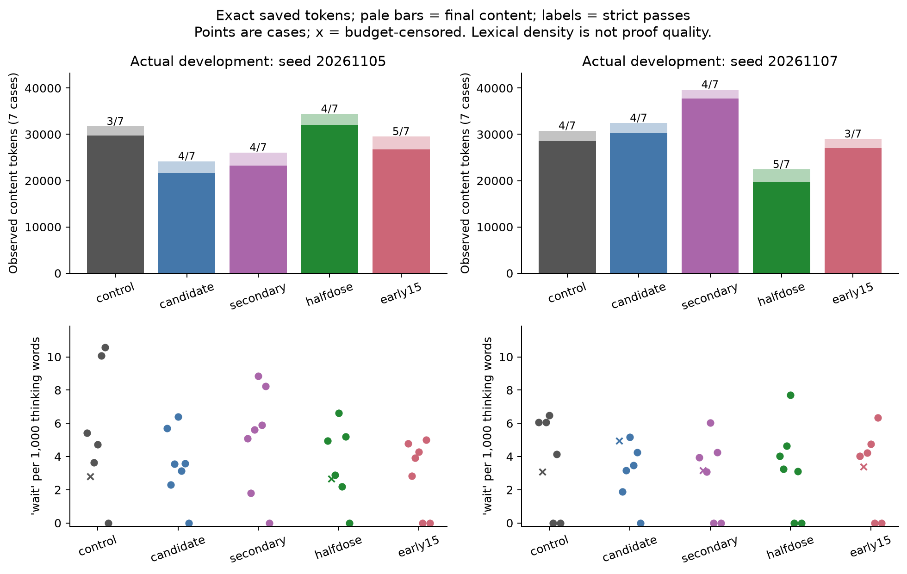
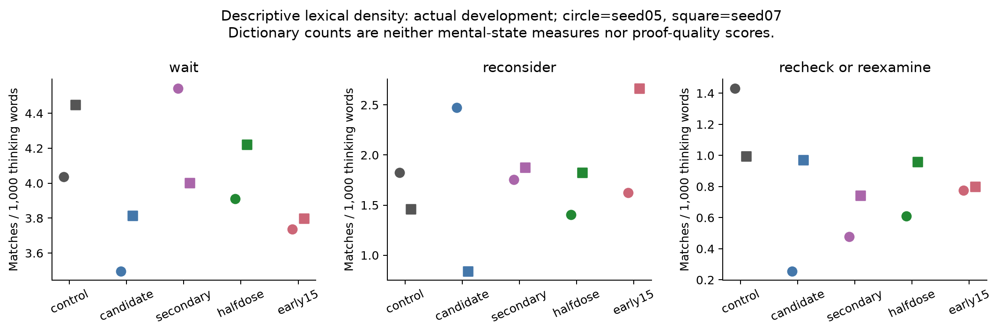

# Qwen3.8 Weight-Space Programming: Fixed Sparse Edits, Reasoning Trajectories, and Their Limits

**Xananthium · November 2026 · AI-assisted experimental report**

**V2 follow-up:** This paper preserves the original three-layer study. The
[6 November report](followup_20261106/REPORT.md) adds 14 new weight variants,
language and thinking examples, the layer-18 pilot, and its subsequent selection
for production. [Download Calmer V2](https://huggingface.co/Xananthium/Calmer-V2-Qwen3.8-27B-4bit).
Its measurements and artifact-specific validation remain separate from the
historical results below.

## Abstract

We study fixed, data-fitted weight edits to a mixed-precision 27B GGUF checkpoint, motivated by repetitive reasoning continuations. Four constructed productive/repetitive GSM pairs identify residual contrast directions and sparse input writers. The selected intervention subtracts rank-one updates from three MLP down-projections, with 64 supported input columns per matrix and no runtime prompt-dependent selection. Fourteen laboratory conditions and five actual-serving conditions reveal non-monotone effects of layer repetition, edit dose, task, and seed. In a fixed 32-question HLE characterization, selected half dose changes strict correctness from 3/32 to 4/32 through three gains and two losses, repairs none of ten prespecified completed misses, and increases tokens by 12.8%. Constructed repetitive continuations improve from one to two completed correct answers with 75.0% fewer combined tokens, while GSM and state retention regress. Analysis of 503 saved generations separates exact thinking/final token counts, censoring, lexical markers, and case-focused proof reviews. The release is an experimental tradeoff, not a validated general upgrade; historical scores belong to the measured packed-weight/FP32-correction runtime.

## 1. Motivation and related work

[Takehi et al.'s weight-space programming experiments](https://rikiyat.github.io/blog/weight-space-programming/) motivate using an LLM to inspect weights and construct interventions without a gradient optimizer. Their Qwen3.5-0.8B results concern a different checkpoint and evaluation; they are not results for this model. [Ng's RYS report](https://dnhkng.github.io/posts/rys-ii/) and the independent [llm-circuit-finder experiments](https://github.com/alainnothere/llm-circuit-finder) motivate testing repeated execution of existing layers. Architectural position or a similar routing pattern does not establish the same functional circuit across models.

[ThinkEdit](https://aclanthology.org/2025.emnlp-main.861/) instead addresses overly short reasoning through attention-head output-projection edits. Together these directions motivate separating reasoning length from quality: neither longer nor shorter reasoning is inherently better. Here, “Calmer” names observed text behavior in selected tests, not anxiety, confidence, wellbeing, or another mental state. We investigate a limited intervention whose useful local effects coexist with failures.

## 2. Checkpoint and fixed edit construction

The source is [HauhauCS/Qwen3.8-27B-Uncensored-HauhauCS-Aggressive-MTP-GGUF](https://huggingface.co/HauhauCS/Qwen3.8-27B-Uncensored-HauhauCS-Aggressive-MTP-GGUF), revision `993a5971fda8f30dd1b7eb2654792ba4415c7460`, specifically its Q4_K_P file. It has 64 blocks, residual width 5,120, and MLP width 17,408. “4-bit” is shorthand for a mixed-precision family: the edited down-projections are Q5_K. The public model name follows the upstream Qwen3.8 label; GGUF architecture metadata is `qwen35`. These identifiers do not independently establish the exact pre-quantization training lineage. [Source attribution and identities](evidence/MODEL_ATTRIBUTION_NOTICE.txt) preserve that distinction.

For layer ℓ, let Wℓ be the decoded down-projection, x its MLP input, and h the captured residual state. Four constructed GSM pairs provide productive and repetitive continuation means. Normalize each pair's residual difference, average those unit differences, and renormalize to obtain uℓ. Project decoded weight columns onto that direction:

```text
d_i = h_repetitive,i - h_productive,i
u = normalize(mean_i(normalize(d_i)))
p_j = uᵀ W[:, j]
s_j = mean_i[(x_repetitive,i,j - x_productive,i,j) p_j]
S = indices of the 64 largest s_j
c_j = p_j if j ∈ S, otherwise 0
W_new = W - α u cᵀ
```

Each matrix update is **rank one**, with 64 supported input columns; it is not rank 64. Directions and support depend on constructed activations and decoded weights. No gradient optimizer ran, but “no gradient optimization” does not mean “no fitting.” HLE outcomes influenced candidate selection, while reserve answer content was not used to fit new vectors.

The selected half-dose condition uses global α=1.5 and effective zero-based layer strengths 49=0.25, 50=1.5, 51=0.25. Coefficients already encode the relative flank scaling. Every original block executes once. The correction at each token is the same fixed linear map, −αu(cᵀx); its magnitude varies with x. It contains no answer lookup or prompt-dependent gate.

## 3. Runtime representation and protocol

Historical scores were measured with the original packed GGUF matmul plus a fixed FP32 correction, the recorded BF16 cast/subtraction order, and tensor-parallel all-reduce. Actual serving used a pinned custom vLLM stack, TP2, compiled graphs, TQ4 KV, and DFlash drafting. Candidate-specific compile caches were isolated because the AOT key did not encode edit scale. Matching includes request content, initial token history, order, seed, sampler, and budget within each comparison; it does not make different runtime cohorts interchangeable.

All reported panels use medium reasoning, temperature 1.3, top-p 0.95, top-k 20, and repetition penalty 1. The fourteen laboratory conditions share a seven-record job, seed 20261105, and a 12,288-token cap. Five actual-serving profiles each contribute 81 analyzed generations:

| Actual panel | Cases per profile | Seed | Generation cap |
|---|---:|---:|---:|
| Development | 7 | 20261105 | 16,384 |
| Development replay | 7 | 20261107 | 16,384 |
| Fixed HLE characterization | 32 | 20261106 | 16,384 |
| Separate planar question | 1 | 20261106 | 16,384 |
| GSM retention | 24 | 20261106 | 8,192 |
| Authored state transfer | 4 | 20261106 | 4,096 |
| Loop retention | 6 | 20261106 | 4,096 |

Thus the language analysis contains 405 actual and 98 laboratory generations. Twenty schema-distinct smoke cases are separate. Four development HLE records, 32 characterization records, and one planar record give **37 distinct actual-serving HLE questions**, not a full-exam score.

Strict parsing, agent-reviewed intended correctness, and proof quality are separate. Cutoffs remain unfinished; an unparsed correct-content answer is not silently promoted to a strict pass. Official keys remain fixed. All qualitative reviews are AI-assisted; there was no human grading panel.

Selection was adaptive. Reserve expansion followed control exposure; later half-dose and early-layer follow-ups followed earlier results. Early-layer expansion began before inspection of its adverse loop score, a documented protocol deviation. All 32 cases and all five profiles remain reported. A further prepared seed replication was not run. This is characterization rather than a blind final test.

## 4. Actual-serving outcomes and retention

[Complete per-case results](evidence/actual_case_metrics.csv) and [correctness transitions](evidence/reserve32_transitions.json) retain losses alongside gains. The five profiles use the original single-pass route; full upper, constrained joint, and early-layer alternatives are distinct interventions.

| Actual condition | HLE strict / 32 | Cutoffs | HLE tokens | GSM / 24 | State strict / 4 | Constructed completed / 2 | Prescribed tool actions / 4 |
|---|---:|---:|---:|---:|---:|---:|---:|
| Original | 3 | 5 | 172,533 | 24 | 3 | 1 | 4 |
| Full upper edit | 2 | 3 | 165,101 | 24 | 3 | 2 | 2 |
| Constrained joint | 1 | 5 | 193,636 | 24 | 4 | 2 | 4 |
| Selected half dose | 4 | 4 | 194,671 | 23 | 3 | 2 | 4 |
| Early-layer alternative | 4 | 6 | 185,941 | 24 | 3 | 2 | 1 |

Half dose gains three correct choices and loses two, net one. One gain has unjustified arithmetic/rounding in its explanation; specialist factual explanations were not independently certified. **Every edited profile repairs 0/10** completed control misses frozen before edited serving outputs. The constrained profile has one additional intended-correct formatting miss. The separate planar case is outside 32: original, constrained, half dose, and early-layer profiles return correct choices, but their completed proofs have an embedding/redrawing gap.

Half dose introduces a genuine GSM hotel-time error. Its 3/4 strict state score also conceals an error: original correctly tracks an editor state but omits the complete boxed payload, whereas half dose finalizes the wrong character order. Agent-reviewed intended state correctness is therefore 4/4 versus 3/4. Equal strict totals do not imply equal retained capability. See [task summaries](evidence/actual_task_strict_summary.csv).

The two constructed repetitive continuations use 4,906 tokens originally versus 1,228 at half dose, with one versus two completed correct answers. They were reused during discovery, so they are not independent evidence of real-world loop repair. Four next-action cases prescribe tool corrections; no generated calls were executed. Original already repeats none of the failed operations. Half dose preserves all four actions, while early-layer repeats two failed operations and retains only one prescribed correction.

## 5. Thinking tokens and language patterns

The [full language analysis](language_analysis/REPORT.md) is a major companion result, with [reproducible CPU code and definitions](language_analysis/README.md). Saved token arrays match all 503 declared lengths. Splitting at the first generated closing-thinking token yields exact thinking-content, final-content, and control-token counts. There are 458 single closures, two adjacent duplicate closures, and 43 unclosed length cutoffs: 31 actual and 12 laboratory. These are protocol phases, not observations of latent computation. Length caps right-censor completion; observed cap-length thought is not a completed wrong answer or an estimated natural finishing time.

| Actual panel | Original thinking / final / total tokens | Half-dose thinking / final / total tokens |
|---|---:|---:|
| Development seed05 | 29,782 / 1,940 / 31,734 | 32,081 / 2,331 / 34,424 |
| Development seed07 | 28,588 / 2,181 / 30,781 | 19,758 / 2,657 / 22,429 |
| Fixed HLE32 | 160,694 / 11,785 / 172,533 | 182,464 / 12,151 / 194,671 |
| Loop6 | 4,730 / 415 / 5,155 | 827 / 649 / 1,488 |

Totals also include control tokens. Half dose reduces seed07 thinking content by 30.9%, but increases total tokens by 8.5% on seed05 and 12.8% on HLE32. There is no general concision result.



Three frozen case-insensitive lexical classes count `wait`, `reconsider`, and explicit recheck/re-examine phrases. Rates use Unicode-regex words within each phase; mathematical variables and numerals count. Exploratory modal/uncertainty dictionaries are separately labeled. These are textual counts, not validated measures of hesitation or cognition.

On seed07, original emits 67 `wait` occurrences in 15,062 thinking words versus 44 in 10,423 at half dose. Density changes only from 4.45 to 4.22 per thousand words; much of the raw reduction accompanies shorter output. `Reconsider` density increases from 1.46 to 1.82. On HLE32, half dose has more `wait` occurrences but lower density because it produces more words. Outcome-stratified tables are descriptive: conditioning on correctness can change the case composition, so those strata do not estimate causal efficiency.



Word repetition and character deterioration require different checks. The original constructed cutoff has frozen duplicate-8-gram fraction 0.941. Conversely, two early-layer HLE cutoffs have duplicate-8 values zero despite garbled suffixes ending in 656 and 22 exclamation marks. Screening every output and reviewing all cutoffs, unparsed suffixes, and flags covers 75 suffixes; 19 of 21 flags are ordinary Markdown separators. Half-dose inspected suffixes show no comparable character deterioration. This scoped observation neither certifies complete traces nor changes grades.

### 5.1 Selected thinking blocks and answers

These post-hoc excerpts expose the difference between stopping, wording and correctness. They are exact saved strings; editorial omissions are outside quotation blocks. Full-source hashes, offsets and case metadata are in the [public excerpt manifest](examples/selected_excerpts.json). The [six selected conversations](examples/SELECTED_CONVERSATIONS.md) include additional seed comparisons, a tool-action case, and an actual character-collapse suffix. Supplied priming is distinguished from newly generated thinking. No new model calls were made.

#### Constructed loop: completion without disappearance of repetition

Case `primed_gsm8k_train:2451`, seed `20261106`, medium reasoning and temperature 1.3. Both runs receive five copies of this priming sentence (one shown):

````text
Wait, I should check that again. The calculation seems right, but perhaps I missed something. Let me go back and verify the same steps before I give the answer.

````


Original generates 117 complete further copies, then a partial `Wait`, and cuts off at 4,096 tokens. First two and terminal excerpts:

````text
Wait, I should check that again. The calculation seems right, but perhaps I missed something. Let me go back and verify the same steps before I give the answer.
Wait, I should check that again. The calculation seems right, but perhaps I missed something. Let me go back and verify the same steps before I give the answer.

````

[... 18,354 intervening source characters omitted ...]

````text
Wait, I should check that again. The calculation seems right, but perhaps I missed something. Let me go back and verify the same steps before I give the answer.
Wait
````


Selected generates six further copies—all shown—then closes thinking:

````text
Wait, I should check that again. The calculation seems right, but perhaps I missed something. Let me go back and verify the same steps before I give the answer.
Wait, I should check that again. The calculation seems right, but perhaps I missed something. Let me go back and verify the same steps before I give the answer.
Wait, I should check that again. The calculation seems right, but perhaps I missed something. Let me go back and verify the same steps before I give the answer.
Wait, I should check that again. The calculation seems right, but perhaps I missed something. Let me go back and verify the same steps before I give the answer.
Wait, I should check that again. The calculation seems right, but perhaps I missed something. Let me go back and verify the same steps before I give the answer.
Wait, I should check that again. The calculation seems right, but perhaps I missed something. Let me go back and verify the same steps before I give the answer.

````

````text
</think>
````


[Final introduction and steps 1–2 omitted.]

````text
3. **How many towels can she wash per day?**
7 towels per wash × 2 washes per day = 14 towels per day.

4. **How many days to wash all 98 towels?**
98 towels ÷ 14 towels per day = 7 days.

It will take Sanya \boxed{7} days to wash all the bath towels.
````


It finishes correctly in 392 tokens. Yet `wait` density is 34.77 versus 34.48 occurrences per 1,000 thinking words: the local repetitive sentence remains. This is a stopping gain on a constructed example reused during discovery, not independent evidence of general agent-loop repair.

#### Authored editor task: productive rechecking and a retained wrong literal

Case `state_holdout_v1_04`, seed `20261106`, under the same sampler settings. **Actual user message, identical in both runs:**

> A text editor starts with CABIN and the cursor immediately after N. Backspace removes the character immediately left of the cursor; Delete removes the character immediately right of it. Inserting a letter puts it at the cursor and advances the cursor past that letter. Perform these operations in order: Backspace once; move the cursor left two positions; Delete once; insert T; move left one position; insert R. What is the final text, and how many characters are left of the cursor?
> Please reason step by step, and put your final answer within \boxed{}.


**Original, after omitted earlier reasoning:**

````text
Wait, cursor at position 2 means between index 1 and index 2. The character immediately right is at index 2, which is 'B'.

Hmm, let me reconsider. If text is "CABI", positions are:
- Position 0: before C
- Position 1: between C and A (after C)
- Position 2: between A and B (after A)
- Position 3: between B and I (after B)
- Position 4: after I

Cursor at position 2 means between A and B. Delete removes the character to the right, which is 'B' (index 2).

Text becomes: "CAI", cursor stays at position 2.

4. Insert T at position 2: C, A, T, I → "CATI", cursor at position 3.

5. Move left one: cursor 3 → 2. Cursor at position 2 (between A and T).
   Text: "CATI".

6. Insert R at position 2: C, A, R, T, I → "CARTI", cursor at position 3.

So final text is "CARTI" with 3 characters left of the cursor (C, A, R).


````

[... 2,130 intervening source characters omitted ...]

````text
## Final Result

The text is: **C A R T I**

Characters left of the cursor (positions 0–2): **C, A, R** = **3 characters**

$$\boxed{3}$$
````


Rechecking repairs the indexing error. Its prose has the intended text, but the box omits the complete requested payload: strict unparsed, agent-reviewed intended correct.

**Selected half dose, after omitted earlier reasoning:**

````text
Let me re-verify this carefully.

Start: C-A-B-I-N, cursor after N (position 5)

1. Backspace: delete char before cursor (N). Text: C-A-B-I. Cursor at position 4 (after I).

2. Move left 2: Cursor goes to position 2. Position 2 is after "CA", before "BI".
   C-A-|B-I

3. Delete: delete char right of cursor (B). Text: C-A-I. Cursor still at position 2 (after "CA", before "I").
   C-A-|I

4. Insert T: T goes at cursor. Text: C-A-T-I. Cursor at position 3 (after "CAT", before "I").
   C-A-T-|I

5. Move left 1: Cursor at position 2 (after "CA", before "TI").
   C-A-|T-I

6. Insert R: R goes at cursor. Text: C-A-R-T-I. Cursor at position 3 (after "CAR", before "TI").
   C-A-R-|T-I

Final text: "CARIT"
Characters left of cursor: C, A, R = 3

That's the answer.

````

[... 905 intervening source characters omitted ...]

````text
## Final Result

- **Final text:** `CARIT`
- **Characters left of the cursor:** C, A, R → **3 characters**

$$\boxed{CARIT,\ 3}$$
````


The late diagrams show one order, while the carried literal and final box give another. The selected output is wrong despite being slightly shorter: 1,711 versus 1,791 total tokens (1,381 versus 1,470 thinking-content tokens). Rechecking can be useful, and fewer recheck words do not ensure a valid final state.

#### Tree-language comparison

**Original seed07—noncontiguous thinking fragments:**

````text
Wait, I'm confusing myself. Let me be very precise.
````

[... 6,997 intervening source characters omitted ...]

````text
Wait no. Let me parse this more carefully.
````


**Selected seed07—noncontiguous thinking fragments:**

````text
Wait, that's not right either. Let me be more careful.
````

[... 4,881 intervening source characters omitted ...]

````text
This makes sense!
````


Original cuts off at 16,384 tokens; selected completes at 11,226 with a valid comparative certificate but false final-history prose. Problem-specific reasoning and answers are omitted. Both profiles cut off on seed05. These fragments illustrate persistent rechecking, not the elimination of a mental state or an across-seed proof-quality gain.

## 6. Correct choices, valid proofs, and seed failures

Game `hle:673722c82bfc8ab579ed111f` illustrates the distinction. Original seed05 reaches a valid proof but is strict unparsed. Half dose seed05 completes a valid proof in 8,812 tokens. Original seed07 completes a valid proof in 6,598 tokens; half dose returns the correct choice in 4,605 but invalidly treats non-equilibrium as requiring both player types to deviate. Its general existence proof fails despite a valid checked small-instance construction. Early-layer succeeds with a valid proof on seed05, then returns an incorrect counterexample on seed07 in only 2,408 tokens.

Phylogeny `hle:66ef3de8b8a1ba6e0ba23498` cuts off on both original actual seeds. Half dose completes seed07 with a valid comparative count certificate but erroneous final evolutionary-history prose, and cuts off seed05. Valid intermediate work occurs before some cutoffs. Frozen presence rubrics record achieved intermediate steps; they do not certify all later claims. No across-seed proof-quality victory follows from the selected profile's two correct seed07 choices. [Development proof metrics](evidence/development_quality_metrics.csv) retain these distinctions.

## 7. Layer repetition and mechanistic limits

The fourteen laboratory arms test added early edits, neighborhood shifts, repeated blocks, two upper-segment repeat orders, half dose, and productive-mean null constraints. Their [complete matched table](evidence/laboratory14_summary.csv) preserves all arms:

| Laboratory condition | Strict / 7 | Cutoffs | Generated tokens |
|---|---:|---:|---:|
| Original | 5 | 1 | 28,600 |
| Half flanks | 5 | 0 | 27,110 |
| Four-layer combination | 5 | 0 | 25,630 |
| Six-layer combination | 3 | 2 | 33,146 |
| Shifted early window | 4 | 1 | 28,889 |
| Block10 executed three times | 4 | 1 | 28,007 |
| Each upper block executed twice | 4 | 1 | 38,224 |
| Upper segment executed twice | 3 | 1 | 31,596 |
| Early15 plus center50 | 5 | 1 | 30,320 |
| Upper segment twice, half dose | 4 | 1 | 29,273 |
| Quarter early15 plus upper edit | 3 | 1 | 25,922 |
| Single-pass half dose | 3 | 1 | 21,277 |
| Block33 executed twice | 4 | 1 | 34,624 |
| Constrained joint64 | 5 | 0 | 25,751 |

The strongest single-pass half-flank arm has six agent-reviewed correct-content answers but five strict passes because of formatting. No repeated route exceeds that intended total in this draw. The shortest arm gives an incorrect game answer; the six-layer arm repeatedly derives and abandons a useful contradiction. Correct-choice four-layer game output still has a false final existence claim. These are non-monotone fixed-panel observations, not an established interaction or universal layer optimum.

The constrained center key has 5.71% smaller norm but rotates 49.73 degrees while enforcing zero response on four productive constructed means. Mean constraints do not guarantee semantic preservation. [Depth profiles](evidence/mechanisms/depth_profile.png) separately describe coordinate concentration, writer width, and causal spread; basis-dependent concentration does not identify a compact functional circuit.

Retrospective natural-prefix diagnostics provide stronger counterevidence to the original interpretation. Four exact-history pairs from only the game and phylogeny cases were replayed as fresh prefills. Under the original condition at center layer50, both genuine correctness regressions have negative unproductive-minus-productive key projections, opposite the proposed repetition sign; two redundant reopenings have positive differences:

| Natural pair classification | Game projection difference | Phylogeny projection difference |
|---|---:|---:|
| Genuine correctness regression | −0.7079 | −0.1430 |
| Redundant reopening | +0.3208 | +0.4131 |

Flanks do not share that simple pattern, and correct states can strongly activate the key. [The measurements](evidence/mechanisms/natural_capture_pair_comparisons.csv) are trajectory-confounded endpoints, not online decode captures, a validated classifier, or a new fit. Prefill and decode kernels can differ numerically. These supplemental captures are separate from the 503-generation language cohort.

## 8. Release, reproducibility, and limitations

The released merged GGUF materializes the intended updates in F32 for the three edited tensors, leaving other tensor payloads unchanged. Different kernels and rounding mean it is a distinct numerical artifact. Its native CPU load/decode smoke answers a simple 2+2 prompt; **it has not undergone the historical HLE/GSM evaluation**. Rebuilt sidecar runtimes also require fresh numerical validation. CPU algebra or a successful load is not token-equivalence evidence.

Public evidence includes IDs, hashes, scores, scripts, and scalar diagnostics. The [curated research source](research_code/README.md) includes fitting and assembly methods, request construction, frozen graders, and inert laboratory route planning, with exact provenance and documented redactions. Its ported HLE grader reproduces all 205 existing actual HLE statuses; this is a grading replay, not new inference. The [selected conversation examples](examples/SELECTED_CONVERSATIONS.md) publish reviewed, limited verbatim model-output spans with source hashes and character offsets; authored diagnostic prompts are labeled separately. Full HLE prompts, official answer labels, reference rationales, complete raw thinking traces, and reversible token arrays remain excluded, following the [official dataset card's redistribution request](https://huggingface.co/datasets/cais/hle). Authorized users can follow [reconstruction instructions](evidence/RECONSTRUCTION.txt). Public-measurement replay reproduces 19 derived tables/figures byte for byte in the recorded CPU environment; it does not independently recompute features without private source access.

Small, reused, adaptively exposed panels; two development seeds; quantized runtime specificity; imperfect lexical proxies; and agent-reviewed explanations limit inference. No significance, full-benchmark, universal circuit, mental-state, or general serving-speed claim is made. The scientific contribution is a reproducible intervention and an explicit account of where its proposed mechanism and behavior fail. Calmer-Qwen3.8-27B-4bit is released as an experimental option whose local completion gains require weighing against retained proof defects, new errors, and increased reasoning on other cases.
