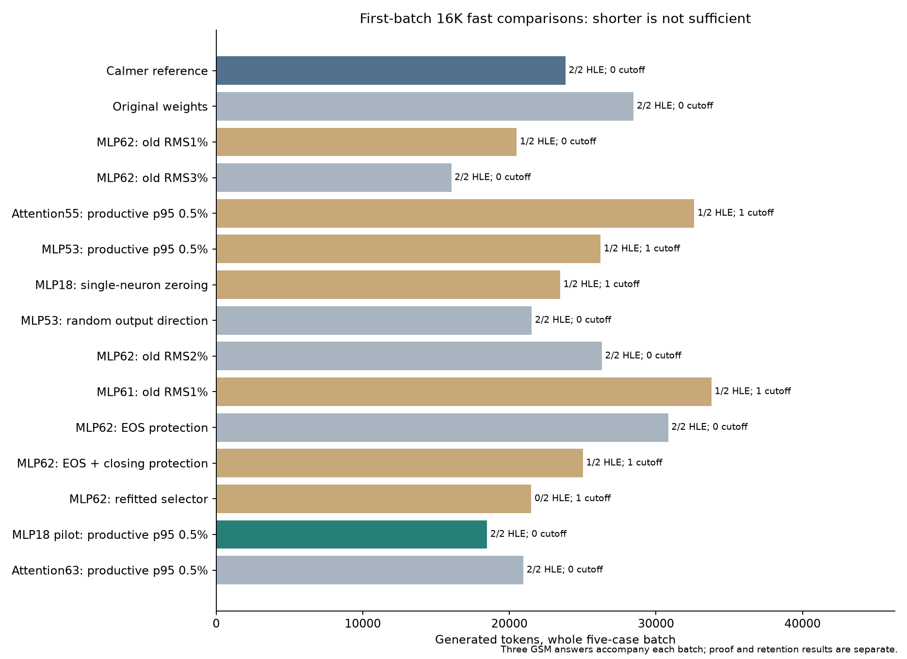
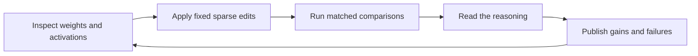
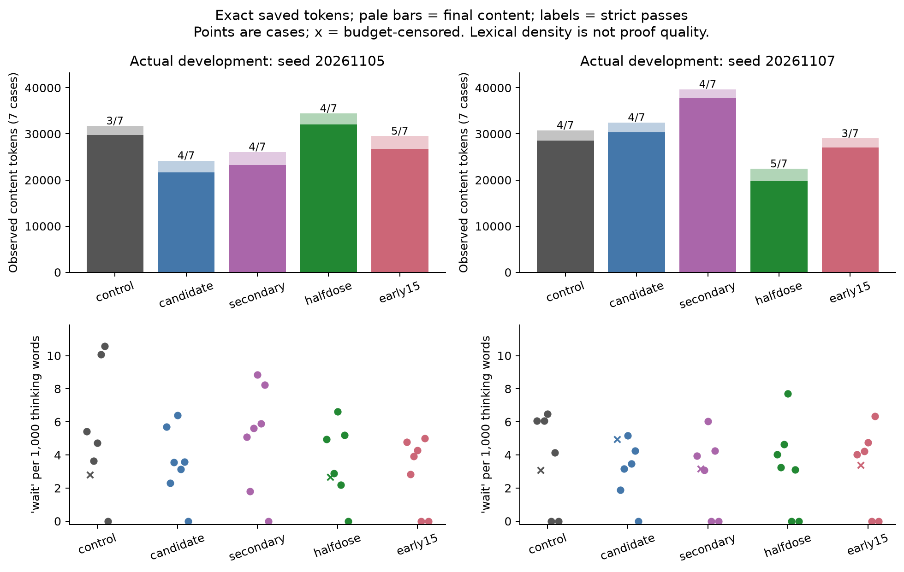

<div align="center">

# Calmer Qwen V2

**Qwen3.8 Weight-Space Programming**<br>
An open experiment in changing reasoning through small, fixed weight edits.

[](https://huggingface.co/Xananthium/Calmer-V2-Qwen3.8-27B-4bit)
[](followup_20261106/README.md)

[](https://github.com/Xananthium/Qwen3.8-Weight-Space-Programming/actions/workflows/public-checks.yml)
[](LICENSE)
[](followup_20261106/REPORT.md)
[](PAPER.md#8-release-reproducibility-and-limitations)

**[V2 research and examples](followup_20261106/README.md)** · **[V1 paper](PAPER.md)** · **[V1 model](https://huggingface.co/Xananthium/Calmer-Qwen3.8-27B-4bit)** · **[Contribute](CONTRIBUTING.md)** · **[Open research questions](ROADMAP.md)**

</div>

---

**Calmer V2 · Qwen3.8 27B · 4-bit** adds a learned sparse correction at **layer 18** to the existing **49/50/51** edits. It grew out of an attempt to reduce repetitive checking while preserving useful reasoning at **medium reasoning, temperature 1.3**. The owner selected V2 for production after trying it and reporting a favorable experience.

The new study explored **14 additional weight variants**, including final-layer edits, attention writers, single-neuron suppression and protected directions. Its leading pilot made a valid game proof shorter and reduced an authored repetition loop. The record also preserves worse explanations, unfinished answers and malformed generations.

## V2 at a glance

| Observation | Calmer V1 reference | V2 pilot |
|---|---:|---:|
| Five-question development panel | 5/5 final answers; 23,831 tokens | 5/5 final answers; **18,481 tokens (−22.45%)** |
| Topology development answer, correct with sound core | 25,467 tokens | **10,648 tokens (−58.19%)** |
| Exact rechecks in primed cookie continuation | 15 | **1** |
| Six-case reviewed content | 6/6 | 6/6 |
| Wider GSM24 check in this follow-up | 24/24 | **Not run for V2** |

The shorter game proof remains valid. The tree still selects the correct answer but adds false event histories; topology retains display/sign errors, and the hat puzzle remains unfinished. These are exploratory observations on previously exposed questions, not full benchmark scores. A driver fault blocked the planned warm/second-seed confirmation. Subsequent successful production use and API checks are separate from that missing evaluation.

**[Download V2 and choose a representation →](https://huggingface.co/Xananthium/Calmer-V2-Qwen3.8-27B-4bit)** The release includes the exact production correction weights and a complete merged GGUF. Measured results belong to the packed-base/FP32-correction runtime; merged export validation is recorded separately.

**[Read the V2 report, language measurements and literal thinking excerpts →](followup_20261106/README.md)** The study contains 248 saved response records and 933,411 observed generated tokens, including one interrupted failure. Counts include repeated questions and are separate from V1's 503-generation archive.



For reproduction, see the [V2 runtime package](runtime/v2/README.txt),
[fitting code and six authored probe pairs](research_code/v2/README.md),
[merged-export evidence](release/v2/README.md), and the public study's
standard-library integrity checker. Replaying the fitter on the frozen private
captures rebuilt the exact selected delta; those captures are not included.
The correction weights, exporter and
artifact identities are pinned separately from the development measurements.

## Pick a starting point

| You want to… | Start here | What you need |
|---|---|---|
| Try the model | [V2 model card and downloads](https://huggingface.co/Xananthium/Calmer-V2-Qwen3.8-27B-4bit) | A compatible GGUF engine; see artifact-specific validation |
| See the actual behavior | [V2 research and examples](followup_20261106/README.md), [V1 selected excerpts](examples/SELECTED_CONVERSATIONS.md) | A browser |
| Inspect the evidence | [V2 report](followup_20261106/REPORT.md), [V1 paper](PAPER.md), [V1 language analysis](language_analysis/REPORT.md) | A browser; Python for replay |
| Make a contribution | [Contributor guide](CONTRIBUTING.md), [starter tasks](ROADMAP.md) | Python 3.12+ for public checks; no GPU or dataset access needed |



## V1 research archive

The sections below describe the original three-layer release and its historical evaluation. V2's separate study, runtime additions and export records are under [followup_20261106/](followup_20261106/README.md), [runtime/v2/](runtime/v2/README.txt) and [release/v2/](release/v2/README.md).

### A change you can read

In one deliberately primed arithmetic continuation, the original generated **117 complete repetitions** of this sentence and then reached the token limit:

> Wait, I should check that again. The calculation seems right, but perhaps I missed something. Let me go back and verify the same steps before I give the answer.

The selected edit generated six repetitions, closed its thinking block, and completed the calculation:

> 98 towels ÷ 14 towels per day = 7 days.

**4,096 tokens and no final answer → 392 tokens and a correct answer.** Both runs received the same five-repeat priming prefix. This is a constructed stopping/completion example, not a claim about unprompted loops. [Read the exact thinking blocks, context, and counterexamples →](examples/SELECTED_CONVERSATIONS.md)

### What changed — V1

The source is the pinned [HauhauCS mixed-Q4 27B checkpoint](https://huggingface.co/HauhauCS/Qwen3.8-27B-Uncensored-HauhauCS-Aggressive-MTP-GGUF). For each edited matrix, a fixed sparse rank-one update is subtracted:

```text
W_new = W - alpha * outer(u, coeff)
zero-based layers: 49, 50, 51
effective strengths: 0.25, 1.5, 0.25
64 supported MLP input columns per matrix
```

Four constructed productive/repetitive continuation pairs supplied the fitted directions and column selection. No gradient optimizer was used. The intervention has no answer lookup or prompt-dependent controller. All 64 original blocks execute once in the selected model; repeated-block experiments are reported separately.

The historical evaluation used **packed GGUF weights plus a fixed FP32 correction**, with a specific BF16 cast/subtraction order. Hugging Face also contains a **complete merged GGUF**, preserving every other tensor payload and storing the three edited matrices as F32. The merged file passed a native CPU load/decode smoke test, but **has not undergone the historical HLE/GSM evaluation**. Different kernels and rounding matter. The model card documents both representations and their launch instructions.

### Results at a glance — V1

These are local diagnostic panels, not full benchmark results.

| Measurement | Original | Selected half-dose edit |
|---|---:|---:|
| Fixed 32-question HLE text subset, strict correct | 3/32 | 4/32 |
| Prespecified completed HLE misses repaired | — | 0/10 |
| HLE subset total generated tokens | 172,533 | 194,671 |
| Previously exposed GSM8K retention cases | 24/24 | 23/24 |
| Authored state tracking, agent-reviewed intended correct | 4/4 | 3/4 |
| Constructed repetition cases, completed correct | 1/2 | 2/2 |
| Tokens across those two repetition cases | 4,906 | 1,228 |
| Prescribed next-action tool corrections | 4/4 | 4/4 |

The HLE result comprises three gains and two losses, with **12.8% more tokens**. One gained choice has an arithmetic defect. The repetition pair uses **75.0% fewer tokens**, but was reused during discovery. No generated tool calls were executed; the original already handled all four next-action cases correctly.

For the game/tree pair, the selected model gets both choices strictly correct at seed `20261107`. The game explanation has an invalid existence argument; the tree has a valid count certificate followed by false history prose. At seed `20261105`, the game proof is valid and the tree cuts off. The report keeps choice correctness, proof validity, and completion separate.

Five actual-serving profiles were compared on **37 distinct HLE questions**, GSM retention, state tracking, and constructed loop cases. Fourteen additional laboratory conditions tested neighboring edits, early layers, repeated blocks, and constrained directions. Both cohorts and all conditions are retained in the [full report](PAPER.md), [actual case table](evidence/actual_case_metrics.csv), and [laboratory table](evidence/laboratory14_summary.csv).

### Language and thinking patterns — V1

The [language report](language_analysis/REPORT.md) analyzes **503 saved generations**: 405 actual-serving and 98 laboratory. It includes six figures, per-generation measurements, exact thinking/final/control-token accounting, lexical rates, repetition, cutoff analysis, and 75 agent-reviewed output suffixes.



Half dose reduces thinking tokens by **30.9%** on the second development seed, while increasing total tokens by **8.5%** on the first. Normalized “wait” density changes much less than the raw count, and “reconsider” density can increase. Shorter answers can be correct or wrong. Character-level degeneration appears in an early-layer alternative and is missed by a word-level repetition metric.

“Calmer” is a name for observed text behavior in specific tests. The analysis does not measure anxiety, wellbeing, or an internal mental state.

### Reproduce and inspect — V1

| Location | Contents |
|---|---|
| [PAPER.md](PAPER.md) | Construction, protocol, all conditions, results, proof reviews, limitations and related work |
| [examples/](examples/SELECTED_CONVERSATIONS.md) | Selected verbatim prompts, thinking and answers, with omissions and source offsets recorded |
| [language_analysis/](language_analysis/README.md) | Measurement definitions, CPU analysis, public numerical data and figures |
| [evidence/](evidence/RECONSTRUCTION.txt) | Case IDs, frozen grades, timings, artifact hashes, cohort definitions and mechanistic diagnostics |
| [research_code/](research_code/README.md) | Curated fitting, assembly, request construction, API evaluation, frozen graders and laboratory routes; source provenance and redaction details |
| [runtime/](runtime/README.txt) | Portable source for the selected packed-base/FP32-correction representation; exact delta and pinned dependencies |
| [tools/export_calmer_gguf.py](tools/export_calmer_gguf.py) | Reproducible merged export with tensor preservation and algebra checks |
| [release/](release/) | Export inventory, native smoke evidence and release identities |

Regenerate public aggregate tables and plots without downloading a model or benchmark:

```bash
python3 -m venv .venv
. .venv/bin/activate
pip install -r language_analysis/requirements-figures.txt
python language_analysis/analyze_language.py \
  --from-metrics language_analysis/public/generation_metrics.json \
  --output-dir rebuilt
```

This reproduces aggregates from the released measurements. Independently recalculating the features or reviewing historical proofs requires the privately preserved raw traces. See [language-analysis methods](language_analysis/README.md) and [authorized HLE reconstruction](evidence/RECONSTRUCTION.txt). The supplied runtime source requires the pinned custom CUDA/vLLM stack; a clean rebuild has not inherited the original binary's numerical validation.

Public files omit full HLE questions, keys, reference rationales, complete raw traces and reversible token arrays, respecting the [dataset card's redistribution request](https://huggingface.co/datasets/cais/hle). The [selected examples](examples/SELECTED_CONVERSATIONS.md) add reviewed, limited model-output excerpts without reproducing HLE problems or solutions. IDs, hashes and excerpt offsets bind the public evidence to the saved records. The complete local reviewer archive preserves historical material, but is not part of this public repository.

## Build on the experiment

Contributions can be small: improve a confusing explanation, add an original diagnostic question, investigate a repetition metric, or reproduce a result on another runtime. **Well-documented negative results are welcome.**

- **No GPU needed:** check an excerpt, improve an analysis, or add a synthetic grader fixture.
- **Have a GPU:** compare the merged and sidecar representations, test more seeds, or investigate an open question in the [roadmap](ROADMAP.md).
- **Found a problem or have an experiment idea:** [open an issue](https://github.com/Xananthium/Qwen3.8-Weight-Space-Programming/issues/new/choose) with the provided templates.

Start with [CONTRIBUTING.md](CONTRIBUTING.md). Pull requests run public artifact, excerpt, parser, and summary-replay checks. These checks need no model download, GPU, or gated dataset.

## Interpretation and attribution

The panels were small, reused and adaptively exposed. Two development seeds reveal substantial sensitivity. Retrospective natural-prefix diagnostics also challenge the proposed mechanism: at center layer 50, two actual correctness regressions have the opposite projection sign to the constructed repetition hypothesis. This is evidence about a limited intervention, not a universal repetition or correctness circuit.

Prepared by **Xananthium with AI assistance**, including code, experiment design, literature review, language analysis and qualitative proof review. There was no independent human grading panel. Credit to Qwen and HauhauCS for the source checkpoint and to the cited research authors for the motivating methods. The model name follows the upstream Qwen3.8 label; its GGUF architecture metadata is `qwen35`.

Original project material is released under [Apache-2.0](LICENSE); third-party components retain their own notices. See [NOTICE.txt](NOTICE.txt), [runtime notices](runtime/NOTICE.txt), and [rights and attribution](evidence/RIGHTS_AND_ATTRIBUTION.txt).
