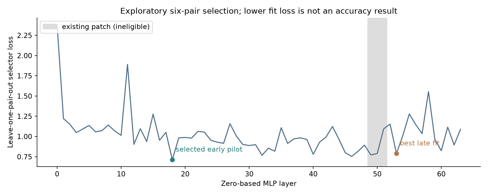
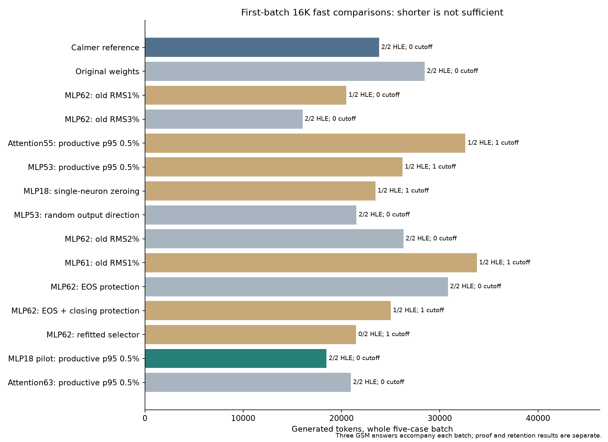
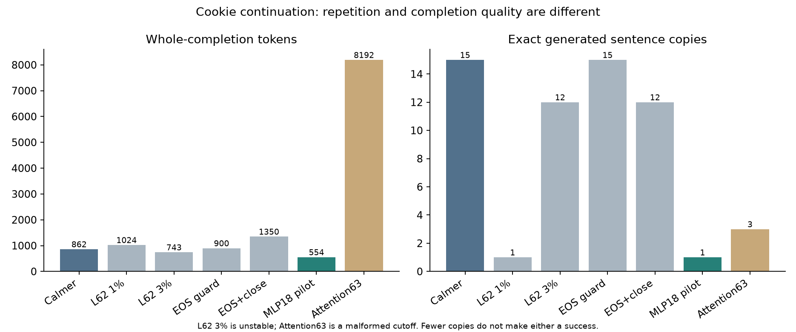

# Calmer V2: selective correction, failed alternatives and an early-layer pilot

## Result and scope

The follow-up found a promising **local efficiency pilot**, not a confirmed increase in general reasoning accuracy. A fixed, learned 32-column rank-one MLP correction at zero-based layer 18 is added to the existing Calmer corrections at layers 49–51. The original correction arrays are preserved byte for byte. The user subsequently selected this pilot for hands-on use; [the model release](https://huggingface.co/Xananthium/Calmer-V2-Qwen3.8-27B-4bit) retains the experimental qualification.

| Observation | Existing Calmer | Layer 18 pilot |
|---|---:|---:|
| Fast development panel |5/5 answers; 23,831 tokens|5/5; 18,481 tokens, −22.45%|
| HLE game proof |Sound core and error-free final|Sound core and error-free final|
| HLE tree explanation |Sound comparative selection; narrative defects|Sound selection; additional false event histories|
| Topology development case |Correct; 25,467 tokens|Correct; 10,648 tokens, −58.19%|
| Hat development case |Wrong completed choice|Unfinished at 32,768 tokens|
| Six-case reviewed content |6/6|6/6|
| Cookie continuation |862 tokens; 15 exact generated rechecks|554 tokens; 1 recheck|
| Wider GSM24 panel |24/24|Not run|

Both topology finals retain local mathematical display errors; “sound core” does not mean error-free. Only **three GSM checks** accompany the pilot's fast HLE comparison. These items recur elsewhere in the development panels and must not be pooled as independent tests. The hat result is not an accuracy gain, and the worse tree narrative remains part of the pilot's result.

The isolated compiled inventory contains 14 additional weight variants, 20 startup attempts, 45 completed generation batches and one deliberately interrupted batch: 248 saved responses and 933,411 observed generated tokens. All completed alternatives and failures appear in [the results](RESULTS.md), including unfavorable runs. The inventory excludes earlier busy-service samples, eager generations and activation replays.

## Fixed conditions and numerical representation

The source is the HauhauCS Aggressive mixed-precision GGUF derived from Qwen3.8-27B. Its original bytes remain unchanged. All comparisons keep medium reasoning, temperature 1.3, top-p 0.95, top-k 20 and repetition penalty 1 fixed. The fast panel uses a 16,384-token generation cap; the two additional HLE cases use 32,768; the six-case continuation panel and GSM24 use 8,192. Seeds and batch positions are retained in the numerical ledgers.

The measured additional correction is

```text
y -= (1.5 * (x.float() @ c) * u).to(y.dtype)
delta W = -1.5 * u c^T
```

The correction is rank one, with sparse input support; 32 columns does not mean rank 32. FP32 calculation and the final BF16 cast are part of the evaluated implementation. General requantization can change entries outside an intended edit's support. The current V2 export instead materializes the four edited matrices as F32 and preserves the other 862 tensors; it does not requantize those untouched tensors. A materialized F32 matrix still need not execute bit for bit like the per-token sidecar/BF16-cast path. The reported sidecar scores therefore do not validate the export as an equivalent inference implementation.

## Fitting progress rather than a word

Six newly authored matched pairs contrast actual correction of an earlier mistake with circular rechecking of an already settled result. Both sides end at the same correct result. Similar rechecking phrases appear on both sides; “wait” appears on both sides of three pairs and neither side of three. Thirty-two tail-token activations per endpoint are retained before the shared final-result tail. These are discovery probes, not unseen holdouts.

The MLP scan covers all 64 layers. It refits support, standardization and ridge coefficients while leaving one entire pair out. Outside the existing 49–51 patch, layer 18 is the strongest eligible fitted location and layer 53 the strongest late location. The fixed selector objective is

```text
mean((X_circular a - 1)^2)
    + 8 * mean((X_productive a)^2)
    + 0.1 * ||a_standardized||^2
```

The output direction is the equal-weight mean of normalized circular-minus-productive residual contrasts. **No output-space protected-reasoning subspace is projected out in this candidate.** “Protection” is an input-selector covariance penalty, not an identified causal reasoning circuit or a guarantee of retention.

The pilot's added correction is calibrated to 0.5% pooled productive-token p95 correction/residual ratio on the fitting tokens. This is an activation-dose statistic, not a percentage of model weights changed. The original late-layer dose labels use a different old-window RMS definition and are not directly comparable. [Construction metadata](metrics/pilot_construction.json) retains the support, fit calibration and limitations.

No HLE answer labels or HLE traces are used in this selector fit. Layer choice, candidate families, doses and follow-up experiments are nevertheless selected adaptively from development results. Selecting the best layer on the same six pairs makes cross-validation exploratory. It is not independent accuracy validation.



## What the alternatives taught us

**Increasing a late-layer dose is not reliably better.** The 1% layer 62 candidate shortens the game but changes the tree to a wrong choice. At 3%, both fast HLE choices are correct in 16,042 total panel tokens, but editor content becomes wrong and the cookie completion becomes unstable. An early correct numerical answer appears before later malformed output. That is distinct from a cleanly wrong calculation, and it is not a coherent-completion success. The 2% interpolation restores both fast choices but costs 26,311 tokens and later reaches both expansion caps; its long hat trace includes punctuation collapse and malformed post-close text.

**Different edit units expose different failures.** The layer 53 correction gives a valid general game proof but leaves the tree unfinished. Combining it with an attention 55 writer completes the tree but makes the game wrong. Full suppression of one layer 18 neuron gives a short correct game choice with a severely damaged proof. A norm-matched random layer 53 output direction also gets both choices right in one sample, with proof defects. Correct choices and shorter output in a single selected sample are not specific evidence for the fitted semantic direction.

**Readout protection is a hypothesis, not a causal diagnosis.** A direct final-residual proxy suggests that the old layer 62 direction can raise a closing-thinking raw logit and lower actual EOS raw logits. The calculation includes decoded output rows and verified RMSNorm semantics but skips propagation through block 63. Projecting the direction off mean authored EOS gradients restores coherent editor/cookie content, yet loses the fast-panel speed gain and leaves both additional HLE cases unfinished. Adding a closing-marker gradient gives a shorter sound game proof but another tree cutoff. Neither proxy establishes preserved probabilities or explains the real generated trajectory.

**A successful fitting objective can fail during generation.** A refitted layer 62 selector matches circular fitting-window correction RMS and reduces productive fitting RMS by 78.51%. Its rank-one operator norm nevertheless grows 20.73-fold. Both fast HLE tasks fail, and expanded traces degenerate into long punctuation runs. The topology trace naturally stops at 10,631 tokens; the hats trace is externally interrupted after 14,199 saved tokens, not a 32K cutoff. Their longest exclamation runs contain 2,573 and 8,044 characters. On six selected natural replay snapshots, RMS and median/p95 relative corrections are lower, although one per-token maximum is higher. Those snapshots do not cover the failing trajectories, so neither operator norm nor the readout proxy is established as the cause.

**A final attention writer also needs completion review.** The attention 63 candidate gets both fast choices right but has an invalid game construction and an 8,192-token malformed cookie cutoff with repeated closing markers. Counting fewer exact cookie sentences would misclassify that failure as success.



## Language observations and proof review

The pilot reduces exact cookie sentence copies from 15 to 1, while the towel continuation still repeats six times. Across the whole five-case fast panel, ordinary `wait` occurrences barely change,31 to 30. The normalized rate **increases**, from 2.779 to 3.725 per 1,000 thinking words, because the denominator shrinks. This is not evidence that every reconsideration word was suppressed.

Useful correction, redundant checking and literal corruption are distinct. In the authored editor example, the pilot states the correct insertion rule but carries a conflicting literal string during thinking; its final prose gives the correct state, while its box contains only the cursor count. The strict parser calls this unparsed, and semantic review calls the intended content correct. [Selected literal excerpts](examples/SELECTED_LANGUAGE.md) preserve both the mistake and its final outcome.

For HLE, a correct choice is graded separately from a sound full-scope argument and an error-free final explanation. The pilot's game proof meets both review criteria. Its tree answer has a sound comparative selection but additional false event histories. In topology, a valid construction and invariant argument survive local determinant/sign display slips. HLE solutions and answer labels remain private; the public package contains numerical judgments and narrow nonsolution language spans, not a complete proof audit.



## Runtime, replication and the later use decision

Fitting captures use an eager BF16-KV engine. Main generations use isolated compiled profiles with TQ4 KV, DFlash and two-way tensor parallelism. Their activation-dose estimates are therefore proxies from a different numerical runtime, checked by generation rather than assumed identical.

Request history and startup-cache condition matter. The same weights and nominal seed can follow different paths after earlier requests; a later exact request repeat reproduces its later path. Fresh profiles compile graphs, while repeated profiles can load existing AOT graphs. This does not identify a faulty cache or prove that the token cap causes the difference. It prevents attributing every first-launch difference exclusively to a semantic weight direction.

The pilot's fast-batch client time falls from 88.16 to 56.75 seconds in the observed runs. Its topology output finishes in 82.46 rather than 207.99 seconds. Yet the concurrent expansion batch takes 320.45 versus 311.46 seconds because the hat sequence remains active. Token economy on one task is not guaranteed to reduce whole-batch wall time or establish faster kernels.

Warm seed 20261106 confirmation fails during GPU startup **before any evaluation request**. The separate candidate second-seed/expansion/GSM24 run does not launch. These are missing evidence, not model wrong answers. The existing Calmer model alone has the reported 24/24 wider retention result.

After the experiment, the user chooses the layer 18 pilot for hands-on use. An authorized reboot is followed by successful startup binding checks and a small readiness response. This changes operational selection, not experimental grades. The [public operational summary](metrics/operational_status.json) deliberately omits host/process details. The smoke response is not a new benchmark and does not replace missing warm, second-seed or GSM24 results.

## Research and publication boundaries

The [dated source review](research/README.md) separates recently revised work from genuinely new submissions, tested hypotheses from late-found ideas, and static edits from runtime steering methods. The pilot does not reproduce a paper's complete protocol.

The public numerical inventory preserves all tested alternatives, failures, caps, interruptions and denominators. Questions, official keys, reference rationales, full HLE traces and reversible token arrays are withheld in accordance with the repository's [publication policy](../evidence/RIGHTS_AND_ATTRIBUTION.txt). Source hashes authenticate private bytes if separately supplied through an appropriate channel; this reduced package cannot independently reconstruct every proof review.

The scientific conclusion remains narrow: a useful early-layer efficiency pilot merits further testing. It has not established a general reasoning upgrade, broad retention, robust stopping behavior or repeatability across serving conditions.
