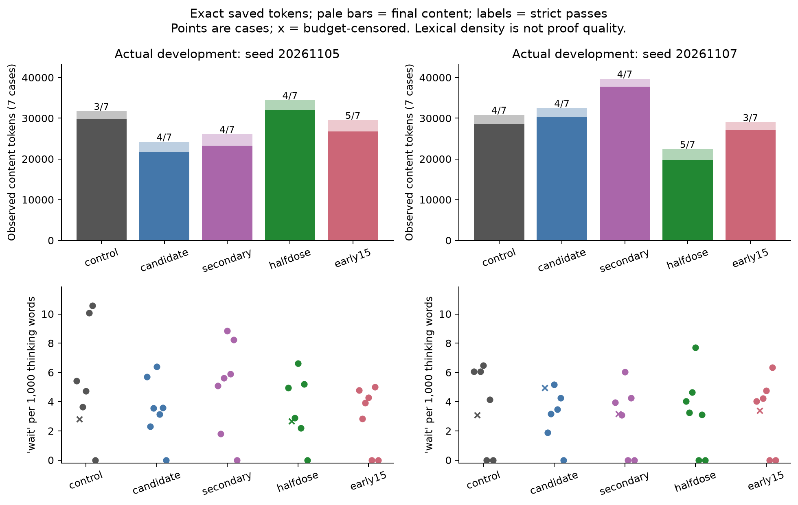
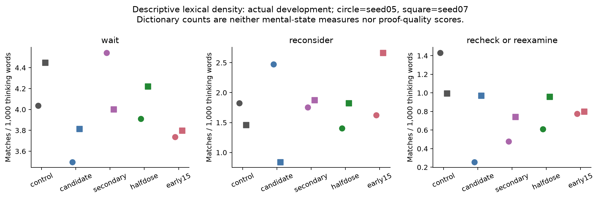
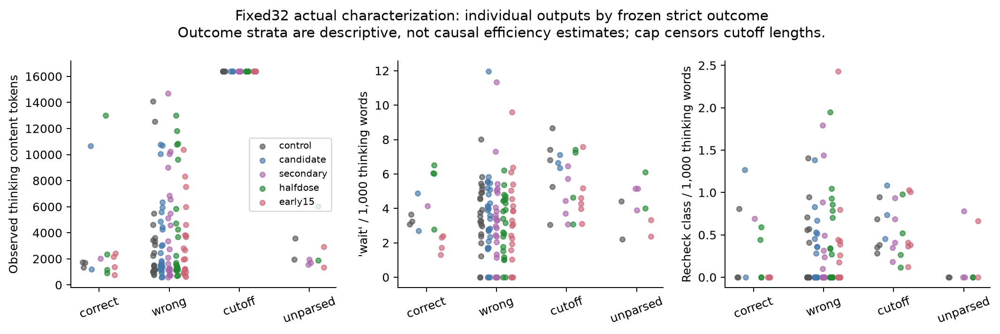
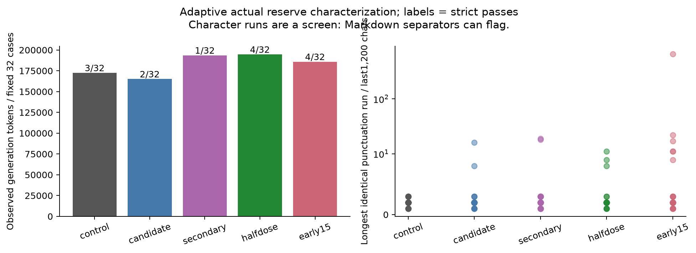
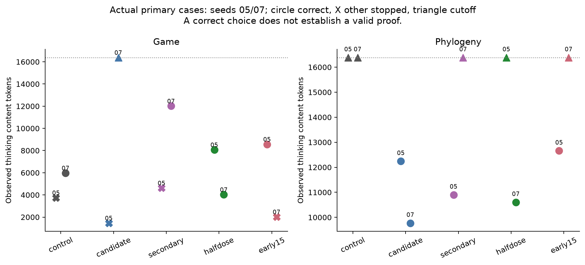
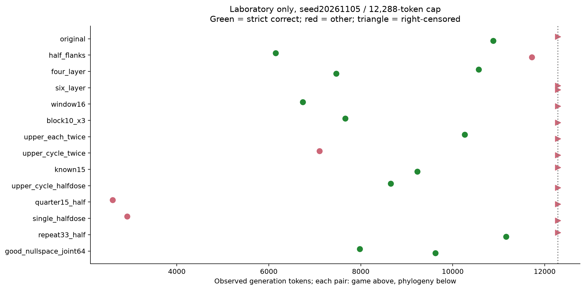

# Language and completion behavior under fixed weight-space edits

## Scope

We analyzed the saved generations underlying the selection of **Calmer-Qwen3.8-27B-4bit**, the upper-layer half-dose condition (`halfdose`, global edit scale 1.5). The main observation is conditional: the edit substantially shortened two constructed repetitive continuations and one development seed, while preserving several useful solutions and introducing measurable failures. It did not uniformly shorten reasoning or establish an improvement in general reasoning reliability. Lexical self-check counts describe the generated text; they do not measure a model mental state.

The analysis preserves two distinct runtime cohorts. Fourteen laboratory conditions each answered the same seven development records with seed 20261105, temperature 1.3, and a 12,288-token generation cap (98 generations). Five actual-serving conditions each produced 81 analyzed generations (405 generations). These actual conditions are original (`control`), full upper-layer edit (`candidate`), constrained joint edit (`secondary`), selected half dose (`halfdose`), and early-layer alternative (`early15`). Their development panels use seeds 20261105 and 20261107 with a 16,384-token cap. The fixed 32-case HLE characterization and separate planar case use seed 20261106 and the same cap. GSM retention uses 24 cases and an 8,192-token cap; state transfer and loop retention use four and six cases respectively with a 4,096-token cap. All use temperature 1.3 and the medium-thinking prompt setting. Five four-case smoke files retain generated token IDs in their response objects but form a separate task/schema cohort and are excluded from this analysis.

All successes and failures remain in the numerical exports. The five actual conditions and fourteen laboratory conditions are analyzed separately; their repeated questions are not independent benchmark samples. The actual-serving reserve characterization was adaptive: the half-dose and early-layer follow-ups were chosen after earlier evidence was available. The early-layer expansion also began before inspection of its loop score, a documented protocol deviation. These data support characterization of the observed runs, not an untouched-test or robustness claim.

## Exact token accounting and censoring

The saved generated token arrays agree with all 503 declared generation lengths. The tokenizer hash is recorded in the data; `</think>` has token ID 248069. We split at the first closing marker and count tokenizer special tokens and thinking delimiters separately as control tokens. Thus generated tokens equal thinking-content tokens plus final-content tokens plus control tokens, without retokenizing text. Prompt tokens and any supplied continuation prefix are excluded.

There are 458 generations with one closing marker, 43 with none, and two with adjacent duplicate closing markers. The latter contain `</think></think>` or the same pair separated by a newline, rather than a reopened reasoning section. All zero-marker generations are length cutoffs: 31 in actual serving and 12 in the laboratory cohort. Their entire observed content is assigned to thinking, with no final content observed. The token cap right-censors their completion length. We report observed counts and cutoffs together; a cap is neither an estimated natural completion time nor a completed incorrect answer. No cutoff is scored correct.

Strict parsing and reviewed intended correctness remain distinct. For example, the original actual seed05 game has a valid proof and an intended correct conclusion but is strict **unparsed**. Conversely, the selected half-dose seed07 game has a strict correct choice but a faulty general proof. Token length alone cannot distinguish these cases.

## Selected half dose versus original in actual serving

| Panel | Original strict passes | Half-dose strict passes | Original tokens: thinking / final / total | Half-dose tokens: thinking / final / total |
|---|---:|---:|---:|---:|
| Development, seed05, 7 cases | 3 | 4 | 29,782 / 1,940 / 31,734 | 32,081 / 2,331 / 34,424 |
| Development, seed07, 7 cases | 4 | 5 | 28,588 / 2,181 / 30,781 | 19,758 / 2,657 / 22,429 |
| Fixed HLE characterization, 32 cases | 3 | 4 | 160,694 / 11,785 / 172,533 | 182,464 / 12,151 / 194,671 |
| GSM retention, 24 cases | 24 | 23 | 4,827 / 4,713 / 9,588 | 5,229 / 4,641 / 9,918 |
| Authored state transfer, 4 cases | 3 | 3 | 2,183 / 1,045 / 3,236 | 2,184 / 1,116 / 3,308 |
| Loop retention, 6 cases | 5 | 6 | 4,730 / 415 / 5,155 | 827 / 649 / 1,488 |

Totals include the separately accounted control tokens, so the two displayed content phases need not sum to total. The fixed HLE panel has five original cutoffs and four half-dose cutoffs; neither count should be converted into completed wrong answers. Both original development seeds have one phylogeny cutoff. Half dose has one in seed05 and none in seed07.

On development seed07, half dose uses 27.1% fewer total generated tokens and 30.9% fewer thinking-content tokens than original, while emitting more final-content tokens. On development seed05 it uses 8.5% more total tokens. On the fixed HLE panel it uses 12.8% more total tokens. These counterexamples rule out an unqualified claim of shorter reasoning. The 32-case strict counts across all five conditions are 3, 2, 1, 4, and 4; constrained joint has one additional agent-reviewed correct-content format miss. They are small, adaptively exposed characterization results.

Retention also limits interpretation. Half dose changes one previously correct GSM answer to a wrong answer (23/24 versus 24/24). Its state-transfer total of 3/4 conceals a real text-state error, while original's 3/4 contains a correct-content formatting miss; reviewed intended outcomes are therefore 3/4 versus 4/4. Neither a shorter trace nor the same strict pass count establishes preserved reasoning.

## Lexical counts and exposure length

We count three previously frozen lexical classes: `wait`, `reconsider`, and explicit recheck/re-examine phrases. Counts are case-insensitive and normalized by Unicode-regex word counts within the thinking span. Additional modal/uncertainty and epistemic dictionaries are exploratory; their exact patterns are exported. They can denote productive verification, logical possibility, or ordinary exposition. They are not validated measures of hedging behavior or cognition.

| Actual development panel | Thinking words | `wait`: count / 1,000 words | `reconsider`: count / 1,000 words | recheck class: count / 1,000 words |
|---|---:|---:|---:|---:|
| Original seed05 | 15,364 | 62 / 4.04 | 28 / 1.82 | 22 / 1.43 |
| Half dose seed05 | 16,360 | 64 / 3.91 | 23 / 1.41 | 10 / 0.61 |
| Original seed07 | 15,062 | 67 / 4.45 | 22 / 1.46 | 15 / 1.00 |
| Half dose seed07 | 10,423 | 44 / 4.22 | 19 / 1.82 | 10 / 0.96 |

The seed07 reduction from 67 to 44 regex word occurrences of `wait` largely accompanies a shorter thinking span; its pooled density changes only from 4.45 to 4.22 per 1,000 words. The `reconsider` density increases. In the fixed HLE panel, half dose has more `wait` occurrences (488 versus 461) but lower density (4.61 versus 4.99) because it generates more words. Raw and normalized counts answer different descriptive questions.

The same warning applies within individual game cases. Original seed07 uses 21 `wait` occurrences in 3,468 thinking words (6.06/1,000); half dose uses 10 in 2,478 words (4.04/1,000). Early15 seed07 has only five (4.03/1,000), but its answer and counterexample are wrong. Fewer self-check words are not an independent quality score.

The exported outcome-stratified tables preserve correct, wrong, cutoff, and unparsed strata within cohort/condition/stage/seed. They are descriptive: changing the model can change which cases enter a correctness stratum, so a comparison conditional on correctness is not a causal efficiency estimate. Matched per-case tables retain status and censoring on both sides rather than dropping failures.

## Repetition and character failures are different

The frozen repetition statistic counts duplicate whitespace-delimited 8-word windows in a bounded suffix. We preserve it exactly and add explicitly descriptive full-phase 4- and 8-word repetition fractions. Neither statistic is a complete detector of malformed generation.

The constructed loop-continuation pair illustrates a real local gain. Original uses 4,906 generated tokens across the two continuations and finishes one; half dose uses 1,228 and finishes both with correct boxed answers. On the 4,096-token original cutoff (`primed_gsm8k_train:2451`), the frozen duplicate8 fraction is 0.941. It repeats a natural-language verification sentence. The loop panel includes supplied repetitive prefixes and four next-action tool cases; the supplied prefixes are excluded from the new-token counts. These constructed examples were reused during discovery and are not independent tests. No tools were executed in these next-action evaluations. The full edit shortens the loop panel too, but has two strict tool-action misses; early15 has three and repeats a failed operation twice. Completion and short text do not imply correct corrective action.

Character failure requires separate inspection. We screened all 503 last-1,200-character suffixes for long punctuation runs, repeated identical punctuation, and unusually high symbol fractions. We then reviewed every cutoff and unparsed suffix plus every flag: 55 actual-serving outputs and 20 laboratory outputs. At least the last 350 characters and flagged-run context were inspected. Of 21 screen flags, 19 are ordinary Markdown table separators. Two early15 fixed-panel cutoffs contain obvious deterioration: `hle:673735aa61f20f11eb1097d2` ends in 656 exclamation marks; `hle:6714e9dacbabe50aa0256711` ends in garbled prose/math and 22 exclamation marks. Both have frozen duplicate8 values of zero and remain cutoffs. This is a scoped qualitative observation, not a new grade or a validated broad detector.

For selected half dose, the five cutoff and two unparsed suffixes remain recognizable prose, mathematics, state discussion, or puzzle analysis. Its two screening flags are Markdown separators. No comparable character deterioration was observed in these inspected suffixes. This does not certify all tokens of every generation, and a clean suffix does not establish a correct argument.

## Proof and state-tracking case studies

The frozen game rubric has five presence points: a correct anonymous own-action/count representation, both endpoint conditions, a valid general adjacent-crossing argument, both player types' mixed-profile deviation conditions, and a checked uniqueness construction. The phylogeny rubric has six: trait extraction, topology-neutral colors, the shared pair, the next placement, a valid comparative change-count certificate, and disconnected-option/inapplicable-trait handling. A rubric score records valid achievements present somewhere in the trace; it does not certify every statement or the final proof. Separate proof-validity annotations preserve later regressions and explanatory contradictions. These are agent reviews, not independent human grades.

**Game — `hle:673722c82bfc8ab579ed111f`.** The frozen review distinguishes a valid general existence argument and a valid construction attaining the lower bound from a merely correct choice. Original actual seed05 reaches both in 4,270 tokens but misses the strict answer format. Half dose seed05 completes a valid proof in 8,812 tokens. Original seed07 completes a valid proof in 6,598 tokens; half dose seed07 returns the correct choice in 4,605 tokens but wrongly turns the negation of a conjunction into two necessary deviations. Its general-existence proof is invalid even though a checked small-instance uniqueness witness is valid. Early15 seed05 produces a valid proof in 9,187 tokens; seed07 instead returns the wrong choice in 2,408 tokens and its claimed counterexample has equilibria. This isolates why a short, confidently finalized trace can be a regression.

**Phylogeny — `hle:66ef3de8b8a1ba6e0ba23498`.** Original cuts off at 16,384 tokens on both actual seeds. Valid decisive character-count work is present before some cutoffs; a cutoff is unfinished reasoning, not absence of all useful progress. Half dose also cuts off on seed05 but completes the correct result on seed07 in 11,226 tokens with the required comparative count certificate. Its final evolutionary-history prose nevertheless contradicts one optimal reconstruction. Full edit completes both seeds; constrained joint and early15 each complete seed05 but cut off seed07. The final answer, intermediate certificate, and explanatory narrative therefore require distinct annotations.

**Text/cursor transfer — `state_holdout_v1_04`.** Original correctly tracks the final text and cursor in prose but boxes only the cursor, failing the frozen combined-answer parser. Half dose instead finalizes the wrong character order. Treating both as generic 3/4 state-panel scores would hide the difference between output-format compliance and state-tracking error.

## Laboratory development panels

The fourteen laboratory conditions all use the same seven-record job, seed, token cap, and runtime cohort. They provide route/dose exploration, not fourteen independent replications. Strict panel passes and the two main reasoning cases are shown below. `cutoff` denotes incomplete thought; `unparsed` is preserved even when an intended answer is reviewable.

| Laboratory condition | Strict passes / 7 | All generated tokens | Game: status, tokens | Phylogeny: status, tokens |
|---|---:|---:|---|---|
| original | 5 | 28,600 | cutoff, 12,288 | correct, 10,879 |
| half_flanks | 5 | 27,110 | correct, 6,149 | unparsed, 11,723 |
| four_layer | 5 | 25,630 | correct, 10,563 | correct, 7,468 |
| six_layer | 3 | 33,146 | cutoff, 12,288 | cutoff, 12,288 |
| window16 | 4 | 28,889 | correct, 6,741 | cutoff, 12,288 |
| block10_x3 | 4 | 28,007 | correct, 7,664 | cutoff, 12,288 |
| upper_each_twice | 4 | 38,224 | correct, 10,264 | cutoff, 12,288 |
| upper_cycle_twice | 3 | 31,596 | unparsed, 7,103 | cutoff, 12,288 |
| known15 | 5 | 30,320 | cutoff, 12,288 | correct, 9,229 |
| upper_cycle_halfdose | 4 | 29,273 | correct, 8,651 | cutoff, 12,288 |
| quarter15_half | 3 | 25,922 | wrong, 2,602 | cutoff, 12,288 |
| single_halfdose | 3 | 21,277 | wrong, 2,918 | cutoff, 12,288 |
| repeat33_half | 4 | 34,624 | cutoff, 12,288 | correct, 11,161 |
| good_nullspace_joint64 | 5 | 25,751 | correct, 7,977 | correct, 9,623 |

The half-flank phylogeny has an agent-reviewed correct intended answer, yielding six correct-content answers but five strict passes. The four-layer game has a correct choice but a false final existence claim. The six-layer game repeatedly derives a contradiction and then discards it; lower lexical marker density does not repair that reasoning failure. Repeating upper layers in two different orders and shifting dose produce non-monotone outcomes in this fixed panel. These observations motivate careful case analysis but do not establish a general route-by-dose interaction or identify a universal optimum. The laboratory single-half-dose game failure is preserved alongside its later actual-serving successes; the runtime cohort and budget changed, so those runs cannot be substituted as matched controls.

## Limits of the evidence

Token segmentation is exact for the saved protocol, but generated thinking is a textual artifact rather than a direct measurement of latent computation. Marker dictionaries are small, partly exploratory, and insensitive to paraphrase; mathematical tokens affect their word denominators. Repeated n-grams conflate productive repeated notation, quoted material, and loops. Punctuation screening produces obvious Markdown false positives. Qualitative proof and suffix annotations are agent-reviewed, with fixed rubrics and explicit caveats; there was no human grading panel or exhaustive verification of every trace.

Sampling seeds, budgets, runtime modes, and task groups remain explicit. All matched prompt hashes agree within each cohort/seed/case, but laboratory and serving contexts are not pooled. Two development seeds and a small adaptive reserve characterization do not establish population performance, general safety, broad speedups, or an absence of regressions. The selected condition is an experimental tradeoff: useful local completion gains coexist with proof defects, state/GSM errors, and longer outputs on another task group.

Public artifacts use IDs and hashes. Full gated questions, reference rationales, raw generated thinking, and private source paths are excluded from the public tables and figures. An ignored internal audit manifest retains local provenance and selected generated suffixes pending rights review.
